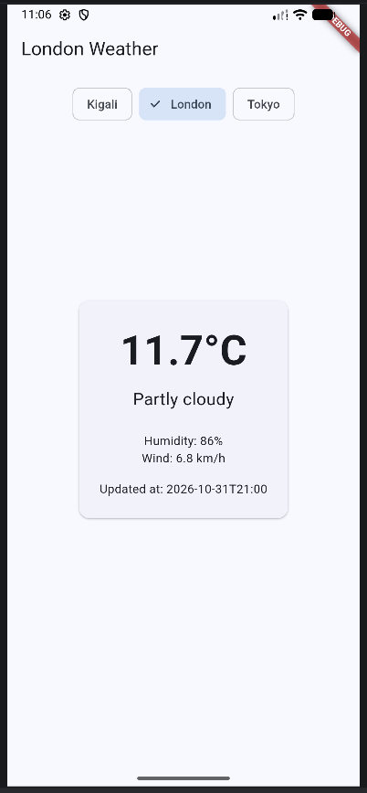
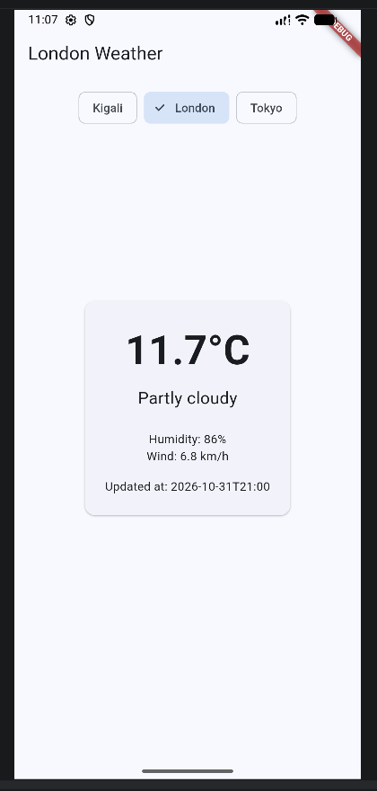
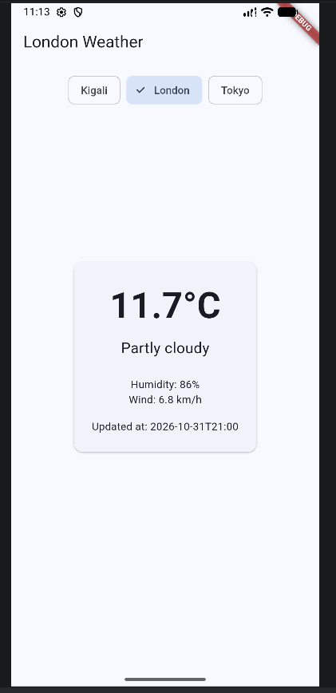
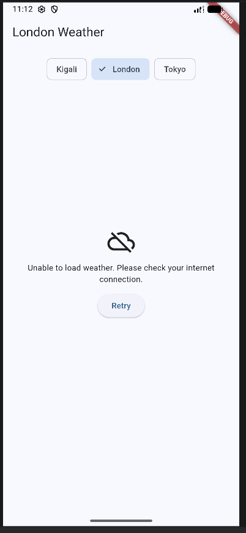

# Kigali Weather App

A Flutter weather app that displays live weather for Kigali, London, and Tokyo using the Open-Meteo API. The selected city is saved on the phone using shared_preferences, so it is remembered when the app closes and reopens.

## Screenshots

### Before closing the app

### After reopening the app

### Live weather from the API

### No internet connection

